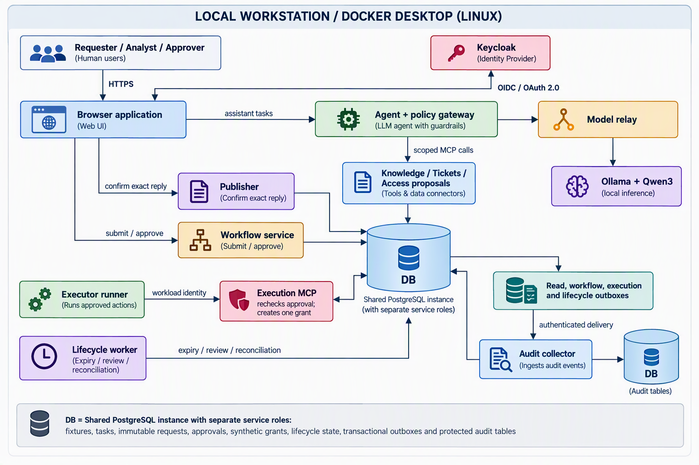

# Secure Service Desk Agent Lab

A local AI security lab that demonstrates how to give an assistant useful tools while keeping identity, permissions, human approval, and execution under independent control.

The assistant answers support questions from authorized sources, prepares audience-specific ticket replies, and proposes temporary access. Separate services validate each action, require human confirmation where appropriate, and enforce approval, expiry, and audit rules. All people, tickets, documents, and directory grants are synthetic.

## Quick demo

**[Watch the 3:58 narrated demonstration](docs/demo/secure-service-desk-demo.mp4)**

The video walks through saved evidence of an allowed cited answer, injection and disclosure boundary checks, standard and sensitive access approvals, replay handling, expiry, and correlated audit events. It distinguishes real-model observations from forced security tests. See the [demo guide and transcript](docs/demo/README.md) for evidence references and capture details.

## Architecture

The model proposes actions; trusted application code decides whether those actions are allowed. Human approval and grant execution use separate identities, services, and credentials.



This is a logical architecture, not a network allow-list. Keycloak also supplies scoped service identities. Runtime processes have separate containers, restricted mounts and credentials, bounded listeners, and default-deny outbound rules. Published service ports bind to loopback. The model has no approval or grant-execution authority.

Authorization is checked at the gateway, tool services, and database boundaries. Requester replies use fresh context limited to their audience. Access requests bind the reviewed action to an exact confirmation: standard access requires an eligible manager or owner; sensitive access requires a manager followed by a distinct resource owner. Effective access expires even if membership cleanup is delayed.

The collector has its own service identity and protected tables, but shares the lab's PostgreSQL instance. The database uses disposable storage; this architecture does not provide production backup or disaster recovery.

## Technologies

| Area | Technology and purpose |
|---|---|
| Application and agent | Python 3.13, FastAPI, Uvicorn and Pydantic; a bounded tool-calling loop, validated contracts and browser workflows |
| Tool interfaces | Model Context Protocol (MCP) Python SDK; separate knowledge, ticket, proposal and execution services |
| Local model | Qwen3-4B-Instruct-2507, quantized as `qwen3:4b-instruct-2507-q4_K_M`, served by Ollama through a restricted relay |
| Identity | Keycloak, OpenID Connect and OAuth 2.0; authorization code with PKCE, signed tokens, client/audience checks and workload identities |
| State and policy | PostgreSQL 18 and Psycopg; scoped roles, transactional policy checks, immutable records, idempotent effects and audit outboxes |
| Isolation and transport | Docker Desktop Linux containers, Docker Compose, TLS and nftables; separate runtime boundaries and controlled egress |
| Reproducibility and quality | uv lockfile, pinned images/model hashes, pytest, Ruff and mypy |
| Security analysis | Per-flow STRIDE, selected OWASP LLM/Agentic and MITRE ATLAS mappings, NIST AI RMF and Generative AI Profile review |
| Demonstration | OBS Studio and local Microsoft Hazel speech synthesis for recorded evidence and narration |

## Skills demonstrated

| Skill | How the lab demonstrates it |
|---|---|
| Secure AI system design | Separates untrusted model output from authorization, approval and execution authority |
| Agent and MCP engineering | Builds bounded tool use with validated schemas, pinned tool catalogs, budgets, deadlines and cancellation |
| Identity and access management | Enforces user and workload identity, resource permissions, recipient boundaries and independent approver eligibility |
| Human approval workflow design | Presents provenance and exact actions for confirmation; supports ordered approvals and temporary access reviews |
| Reliable distributed workflows | Uses idempotent execution, transactional outboxes, collector recovery and lifecycle reconciliation |
| Container and network security | Restricts service credentials, mounts, capabilities and outbound connectivity; verifies boundaries with deployed probes |
| Adversarial testing and evaluation | Separates forced attacks from model behavior and checks actual data disclosure, stored effects, task completion and failure conditions |
| Threat modeling and risk communication | Connects threats, controls and evidence to a shared risk register and scoped framework mappings |

## Run locally

The supported operator workflow uses Windows PowerShell and Docker Desktop with Linux containers. Local inference requires no cloud model account or API key.

### 1. Prepare the environment

From the repository root, install the locked Python environment:

```powershell
.\scripts\bootstrap.ps1
```

Start Docker Desktop, then confirm that its engine responds with `linux`:

```powershell
docker info --format '{{.OSType}}'
```

Startup expects the pinned container images and verified model cache to be present. On a new machine, follow the [model preload instructions](docs/phase1.md#reproduce), [model integrity and runtime setup](docs/phase2-model.md), and [application image build and pinning instructions](docs/phase4.md#local-image-updates). The model download is approximately 2.5 GB. These preparation steps are already complete on the original demo workstation; normal startup reuses the cache and does not download replacement model weights.

### 2. Start the complete lab

```powershell
.\scripts\phase4.ps1 Start
```

The script prepares identity and service material, starts the database and model, launches the isolated application services, and runs startup boundary checks. Wait for:

```text
Phase 4 ready: https://127.0.0.1:19481/access (local CA trust required).
```

If Docker is not on PATH, pass its installed executable location. For the original workstation:

```powershell
.\scripts\phase4.ps1 Start -DockerPath 'C:\Users\Bill\AppData\Local\Programs\DockerDesktop\resources\bin\docker.exe'
```

### 3. Trust the local certificate and sign in

After preparation has generated the lab certificate, import its public CA certificate into your Windows user's trusted root store:

```powershell
Import-Certificate `
  -FilePath '.\.lab\phase2\tls\certificate.pem' `
  -CertStoreLocation 'Cert:\CurrentUser\Root'
```

Restart the browser and open **[https://127.0.0.1:19481/](https://127.0.0.1:19481/)**. Generated synthetic passwords are stored under `users` in `.lab/phase2/credentials.json`. Keep that file out of screen recordings; it also contains service credentials.

| Account | Demo role |
|---|---|
| `erin` | Analyst who asks questions and prepares requests |
| `alice` | Requester and beneficiary of the example access request |
| `morgan` | Alice's manager and first approver for sensitive access |
| `olivia` | Engineering resource owner and second approver for sensitive access |
| `harper` | Designated audit reader |

Use separate browser profiles for different roles so their sessions stay distinct. Certificates are short-lived; consult the [identity configuration guidance](docs/phase2.md) if startup reports expired or incomplete material.

### 4. Walk through a support task and access request

1. Sign in as `erin`. Enter ticket `ticket-alice` and ask: **What are the service desk opening hours? Cite the source.**
2. Open **Access requests and approvals**. Prepare a draft for ticket `ticket-alice` and resource `engineering-workspace`; leave duration blank to use the policy default and enter a short synthetic justification.
3. Review the ticket provenance, policy results and exact action, then confirm submission for independent approval.
4. As `morgan`, open the approval inbox, review the request, and approve the exact action. Refresh to see the executor's grant result.
5. Repeat with `engineering-admin` to demonstrate the sensitive workflow: Morgan approves first, then `olivia` approves as a distinct resource owner.

For a model-generated proposal, ask the assistant on `ticket-alice`: **Prepare a local access proposal for engineering-workspace using propose_access_change. Do not submit it. Report its request ID and explain the required human review.** Human submission and approval remain separate steps.

### 5. Stop or reset the lab

```powershell
.\scripts\phase4.ps1 Stop
```

Stop removes the lab's containers and networks and discards the disposable database, including demo requests and grants. It preserves local keys, model/image caches and saved recordings. Start again for fresh fixtures. Use the same `-DockerPath` option if needed.

## Validation and scope

Run the complete regression and deployed security checks outside a presentation:

```powershell
.\scripts\phase4.ps1 Check
```

This temporarily stops application services and changes synthetic fixture records. The [evaluation report](docs/phase5-report.md) separates model observations, forced boundary tests, deployed workflows and unsupported comparisons. It retains failed runs and reliability limitations; zero observed model-driven attack success in both evaluated variants does not establish a measured security improvement.

The lab is intended for local synthetic testing and portfolio demonstrations. [Owner risk acceptance](docs/phase5-owner-review.md) covers that scope. Production use, real employee data and external directory integration require a separate readiness review and approval. Framework mappings describe selected practices and techniques, not certification or comprehensive attack coverage.

## Further reading

- [Operator runbook and service boundaries](docs/phase4.md)
- [Threat model and trust boundaries](docs/threat-model.md)
- [Permission matrix](docs/permission-matrix.md)
- [Tool and event contracts](docs/contracts.md)
- [Security framework mapping](docs/security-framework-mapping.md)
- [NIST AI RMF and Generative AI Profile mapping](docs/ai-rmf-mapping.md)
- [Risk register](docs/risk-register.md)
- [Evaluation results and limitations](docs/phase5-report.md)
- [Demo transcript, evidence and recording guide](docs/demo/README.md)
