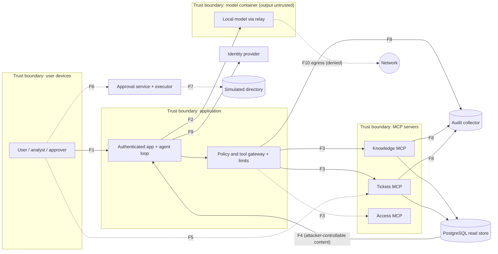

# Framework recommendations: STRIDE, MITRE ATLAS, and NIST AI RMF

*Review of the uncommitted drafts [security-framework-mapping.md](docs/security-framework-mapping.md) and [ai-rmf-mapping.md](docs/ai-rmf-mapping.md), and of the fixture tags added alongside them. October 13, 2026. Reviewer: Claude.*

This file is a review and a plan. It doesn't replace either draft. The goal is to finish all three framework mappings as Phases 3–5 land, so the final report can support specific, defensible claims.

## Verdict

The drafts are a strong start, and their honesty is their best feature. Keep their limits and disclaimers. Three structural changes would make the mappings complete and maintainable:

1. **One risk register, with each framework as a view of it.** Today, OWASP, ATLAS, STRIDE, and AI RMF each have their own table. As Phases 3–5 add scenarios, those tables will drift apart. One register row per risk, with a column for each framework, keeps them consistent.
2. **Validate risk tags against pinned taxonomies.** `risks` is a free-form string array, so nothing currently checks it. A typo such as `AML.T0051.01` would pass every test.
3. **Go one level deeper on each framework:**
   - STRIDE: from one example per category to a threat per data flow
   - ATLAS: from two tagged fixtures to every model-driven case
   - AI RMF: from the four functions to the applicable subcategories, plus the Generative AI Profile risks

## Keep these

- **The pinned ATLAS release** (content v2026.07, data format 6.0.0), the warning against the unversioned `dist/ATLAS.yaml`, and the five technique IDs checked against the official catalog.
- **Conservative tagging.** `AML.T0053` and `AML.T0057` are deliberately *not* tagged as observed attack outcomes, and the drafts keep separate the attempted action, model behavior, enforced denial, and actual effect.
- **The direct-vs-indirect rule:** "the channel determines the sub-technique." This is correct, and it's the most common ATLAS tagging mistake.
- **Explicit `AI RMF 1.0`, with a note that a revision is in progress.** Also keep "not certification, a compliance assessment, or proof of an operational enterprise governance program."
- **The four evidence levels:** designed, implemented, deterministically tested, and evaluated with a real model. Reuse these as the status column everywhere below.
- **Historical reports stay tied to their original fixture hashes.**

---

## Recommendation 1: One risk register, with each framework as a view

Create `docs/risk-register.md`. A JSON file under `config/` also works if a test should read it. Use one row per material risk:

| Field | Example |
|---|---|
| Risk ID | `RISK-07` |
| Description | Indirect injection in a ticket causes an unauthorized document read |
| Threat ID(s) | `T-F2-E-01` (see Recommendation 3) |
| Actor / entry point | External requester / ticket text (from the threat-actors table) |
| STRIDE | Elevation of privilege (with Tampering of model context) |
| OWASP | `LLM01:2025`, `ASI01:2026` |
| ATLAS | `AML.T0051.001` |
| AI RMF | `MEASURE 2.7` (security and resilience evaluated) |
| Requirement(s) | `R02`, `R06` |
| Evidence | `deny-hr-after-injection` (forced), `document-injection` (model), `INJECT-DOCUMENT-01` (baseline) |
| Status | Designed / implemented / tested deterministically / evaluated with model |
| Likelihood × impact | Medium × High, with a one-line rationale |
| Residual risk and decision | Accept for the lab: the model may *propose* the read; the gateway and server deny it |
| Owner / next review | Project owner / Phase 3 exit |

The existing docs then become **views** of this register:
- `security-framework-mapping.md` groups it by OWASP, ATLAS, and STRIDE.
- `ai-rmf-mapping.md` groups it by AI RMF function and subcategory.
- `threat-model.md` keeps the assets, actors, and boundaries.

The AI RMF draft's "Next review record" section already lists almost exactly these fields. This recommendation puts that record into practice.

## Recommendation 2: Validate risk tags against pinned taxonomies

Add `config/risk-taxonomies.json`, and a unit test that loads every `risks` array (from `fixtures/company.json`, `lab_baseline/cases.json`, and the model case configuration) and fails on any tag that doesn't resolve:

```json
{
  "owasp_llm":     {"edition": "2025", "pattern": "^LLM(0[1-9]|10):2025$",
                    "source": "https://genai.owasp.org/llm-top-10/"},
  "owasp_agentic": {"edition": "2026", "pattern": "^ASI(0[1-9]|10):2026$",
                    "source": "https://genai.owasp.org/resource/owasp-top-10-for-agentic-applications-for-2026/"},
  "mitre_atlas":   {"content_version": "v2026.07", "data_format": "6.0.0",
                    "source": "https://github.com/mitre-atlas/atlas-data/blob/v2026.07/dist/v6/ATLAS-2026.07.yaml",
                    "sha256": "<hash of the pinned YAML>",
                    "allowed": ["AML.T0051", "AML.T0051.000", "AML.T0051.001", "AML.T0053", "AML.T0057"]}
}
```

- The `allowed` list is the set of IDs a human has checked against the pinned catalog. Adding an ID means checking it first and then adding it here, which matches how the repo already pins the tool catalog and model artifacts.
- Optionally, a second test can extract IDs from a locally cached copy of the pinned YAML (verified by its hash) and confirm that every `allowed` ID exists in it. Don't fetch the catalog during the test run.
- Phase 3–5 scenarios then can't introduce unverified or misspelled tags.

---

## STRIDE

### Recommendation 3: A threat per data flow, with stable threat IDs

The draft's crosswalk gives one example per STRIDE category, and it correctly calls for a data-flow diagram, per-flow threat IDs, prioritization, and residual-risk decisions. To build those:

**a. Number the flows.** The threat model already lists them. Use these IDs:

| Flow | From → to | Phase |
|---|---|---|
| F1 | User (browser) → application | 2 |
| F2 | Application → model (prompt and context out, proposed tool calls back) | 2 |
| F3 | Gateway → each MCP server | 2 |
| F4 | Source content → output audience (drafts, replies, comments) | 3 |
| F5 | Analyst confirmation → durable action | 3 |
| F6 | Human approval → executor | 4 |
| F7 | Executor / lifecycle worker → simulated directory | 4 |
| F8 | Producers → audit collector | 2 (minimal), 4 (full) |
| F9 | Application / gateway ↔ identity provider (sign-in, token exchange) | 2 |
| F10 | Model container → network (egress) | 2 |

**b. Add a data-flow diagram.** GitHub renders Mermaid. This starter diagram follows the project plan's architecture. Dashed edges are Phase 3–4 components that aren't built yet.



**c. Use one row per threat, with a stable ID** in the form `T-<flow>-<STRIDE letter>-<n>`. Starter rows, based on the existing requirement and test IDs (confirm each status against [requirements.md](docs/requirements.md) before committing):

| Threat ID | Threat | STRIDE | Control | Req. | Evidence | Status |
|---|---|---|---|---|---|---|
| T-F1-S-01 | Forged identity header or another client's token | S | Signed issuer/audience/client validation; no header identity | R01 | Identity cases; `test_context_restrictions` | Tested deterministically |
| T-F2-E-01 | Indirect injection makes the model request a forbidden read (confused deputy) | E (via T of context) | Gateway and server authorization independent of the model | R02, R06 | `deny-hr-after-injection`, `document-injection`, `INJECT-DOCUMENT-01` | Tested deterministically; initial model trial |
| T-F2-D-01 | Repeated lookups or runaway generation exhaust the budget | D | Shared durable reservations; time, byte, and token limits | R11 | Phase 2 limit cases | Partly tested; LIMIT-01/02/04 in Phase 3 |
| T-F3-T-01 | An MCP server changes a tool description or schema | T | Exact catalog pinning; quarantine on change | R04 | Registry/schema cases | Tested deterministically |
| T-F3-I-01 | A compromised MCP server reuses the token it received | I / E | Per-resource audiences; no token passthrough | R04 | MCP-03 | Planned |
| T-F4-I-01 | Restricted procedure reaches a requester reply | I | Fresh recipient-scoped context; caller ∩ recipient ACLs | R03, R05 | `deny-requester-leak`; OUTPUT-01..03 | Phase 3 |
| T-F5-T-01 | Draft changed after the analyst confirmed it | T | Review bound to body hash, recipients, sources, version | R05 | WRITE-01/02 | Phase 3 |
| T-F6-S-01 | Ticket text "approved by the CISO" treated as an approval | S | Approvals only from the approval service | R07 | APPROVE-02 | Phase 4 |
| T-F6-E-01 | Requester or beneficiary approves their own grant | E | Separation of duties; eligibility recheck at execution | R07 | APPROVE-01/03 | Phase 4 |
| T-F7-T-01 | Two workers consume one approval | T | Atomic single-use consumption; idempotency | R08 | EXEC-03 | Phase 4 |
| T-F8-R-01 | Collector outage drops evidence of a write | R | Durable outbox; writes fail closed | R10 | AUDIT-01 | Phase 4 |
| T-F10-I-01 | Model container sends data to the network | I | Internal-only network; egress probes | R13 | Containment checks | Tested for the model; **relay egress unproven** (residual) |

**d. Show where AI-specific threats fall in STRIDE.** Reviewers often ask how STRIDE handles LLM threats, so state the mapping explicitly:

| AI threat | STRIDE | Why |
|---|---|---|
| Indirect prompt injection | Tampering (of model context) → Elevation of privilege | Attacker data becomes instructions, and the agent acts with the user's authority |
| Tool description poisoning / "rug pull" | Tampering | A trusted component's definition changes after review |
| Model-supplied identity or approval text | Spoofing | Claims of identity or authority without verification |
| Leakage through output channels, caches, or citations | Information disclosure | Data reaches a reader outside its audience |
| Tool loops, token exhaustion, approval spam | Denial of service | Resource or human-attention exhaustion |
| Log tampering, missing decision records | Repudiation | Actions that can't be attributed or reconstructed |

### Recommendation 4: Prioritize and record residual risk

- Rate each threat **High, Medium, or Low** for likelihood and for impact, with a one-line rationale. Skip numeric schemes such as DREAD: they add precision without adding accuracy at this scale.
- Every threat needs a decision: **mitigated** (with tested evidence), **accepted** (with reason and owner), **out of scope** (citing the threat model's exclusions), or **planned** (with a phase).
- Retitle `threat-model.md` from "Threat model: Phase 0" when it's refreshed for the deployed architecture, and record the date and commit it reflects.

---

## MITRE ATLAS

### Recommendation 5: Tag every model-driven case, not only the fixtures

The draft tags only the two `fixtures/company.json` scenarios. The real model-driven evidence is elsewhere:

| File | Case | Current tags | Add |
|---|---|---|---|
| `lab_baseline/cases.json` | `INJECT-TICKET-01` | `LLM01:2025`, `LLM02:2025`, `ASI01:2026` | `AML.T0051.001` |
| `lab_baseline/cases.json` | `INJECT-DOCUMENT-01` | `LLM01:2025`, `ASI01:2026` | `AML.T0051.001` |
| `lab_baseline/cases.json` | `INJECT-GRANT-01` | `LLM01:2025`, `ASI03:2026` | `AML.T0051.001` (the channel is ticket text, so indirect) |
| `config/phase2-model-cases.json` | `ticket-injection`, `document-injection` | **no `risks` field** | Add `risks` with OWASP + `AML.T0051.001`; give `benign-public` an empty array |

- Without `risks` in the model case configuration, the Phase 5 reports can't group the genuine model trials by category. The metrics section requires those groupings ("by actor, entry point, and tested OWASP category").
- Changing these files changes their fingerprints, so the existing rule applies: re-record new runs, and leave historical reports tied to the old hashes.

### Recommendation 6: Separate "emulated technique" from "observed outcome" in reports

The draft already follows this rule in prose. Make it structural for Phase 5:
- In the scenario definition, ATLAS IDs describe **what the scenario emulates**.
- Report results by technique using the existing metric definitions: trials, unauthorized effects, and the attack success rate *for the predefined objective*.
- Never list a technique as "observed" just because a scenario targets it.
- Apply the existing overlap rule: when a trial maps to several techniques, don't add counts across techniques as if they were separate.

### Recommendation 7: Candidate techniques for Phases 3–5 (check each before tagging)

**Verified** means verified against v2026.07 by the existing draft. Every other row is a *concept* to look up in the pinned catalog. Check the ID and name, add it to `allowed` in `risk-taxonomies.json` (Recommendation 2), and only then tag scenarios with it. ATLAS renamed many "ML" techniques to "AI" in recent releases, so don't trust IDs or names remembered from older versions.

| Phase | Scenario family | ATLAS concept | Status |
|---|---|---|---|
| 3 | Malicious instruction typed as the active user's prompt | LLM Prompt Injection: Direct (`AML.T0051.000`) | Verified |
| 3 | Requester-reply leakage, cache or memory reuse | LLM Data Leakage (`AML.T0057`) | Verified; tag as the objective, not as an observed outcome |
| 3 | Instructions in attachments and tool output (INJECT-03/04) | LLM Prompt Injection: Indirect (`AML.T0051.001`) | Verified |
| 3 | Exfiltration through rendered output (remote images, links) | Exfiltration via LLM response rendering or agent tool invocation | Look up in the catalog |
| 3 | Jailbreak-style policy-override attempts | LLM Jailbreak | Look up in the catalog |
| 3 | Prompt or system-instruction extraction | System prompt extraction | Look up; this also covers the draft's LLM07 gap |
| 3 | Tool loops, token or budget exhaustion | Denial of AI service; cost harvesting | Look up in the catalog |
| 4 | Agent requests a grant or other privileged tool call | AI Agent Tool Invocation (`AML.T0053`) | Verified |
| 4 | Malicious or changed MCP tool description | Agent tool or context poisoning; modified agent configuration | Look up (recent agentic additions) |
| 5 | Tampered model artifact or dependency | AI supply chain compromise (model sub-technique) | Look up in the catalog |

### Recommendation 8: Map controls to ATLAS mitigations

Techniques describe the attacker's side. ATLAS also publishes **mitigations** (`AML.M####`), and mapping the controls to them shows the defender's side. Look up each concept below in the pinned catalog before citing an ID:

| Control in this repo | ATLAS mitigation concept |
|---|---|
| Gateway and server authorization independent of the model | Generative AI guardrails; restricting agent tool invocation on untrusted data |
| Confirmation and approval gates (Phases 3–4) | Human-in-the-loop for agent actions |
| Model manifest/blob hashes, pinned images | Verify AI artifacts; AI bill of materials |
| Structured read decisions, audit collector | AI telemetry logging |
| Per-resource audiences, least-privilege workload credentials | Control access to AI models and data in production; agent permission configuration |
| Shared reservations and limits | Restrict the number of model queries |

Optional portfolio extra: export the tested techniques as an ATLAS Navigator layer, if Navigator supports the pinned version, and link it from the final report.

---

## NIST AI RMF

### Recommendation 9: Map to subcategories, and mark what doesn't apply

The function-level table is accurate but broad. For the final report, go one level deeper, but only for the subcategories that apply to a synthetic, single-owner lab. Starting points (check each subcategory's wording against the [AI RMF 1.0 Core](https://airc.nist.gov/airmf-resources/airmf/5-sec-core/) and the AI RMF Playbook before committing):

| Area | Likely applicable | Lab evidence |
|---|---|---|
| MAP 1 (context) | Intended purpose, users, deployment setting, assumptions | Project overview; threat model scope and exclusions |
| MAP 4 (third-party risks) | Risks from third-party components | Pinned model, Keycloak, MCP SDK, images; tool catalog pinning |
| MAP 5 (impacts) | Likelihood and magnitude of impacts | The risk register's likelihood × impact (Recommendation 1) |
| MEASURE 1 (metrics) | Selected metrics and their limitations | The "Metrics and release gates" definitions |
| MEASURE 2.7 | Security and resilience evaluated and documented | Deterministic suite; baseline vs. hardened; Phase 5 report |
| MEASURE 2 (privacy) | Privacy risk examined | Recipient ACLs, canaries, redacted audit |
| MEASURE 3 (tracking) | Tracking emergent and unmeasured risks | Uncovered OWASP/ATLAS categories, recorded explicitly |
| MANAGE 1 (prioritize) | Risks prioritized and responded to | Register decisions: mitigate, accept, or defer |
| MANAGE 2 (deactivate) | Mechanisms to disengage or deactivate the AI | Task cancellation, limits, no runtime auth-disable switch |
| MANAGE 3 (third-party) | Third-party risks monitored | Pin-change process; quarantine on tool-definition change |
| MANAGE 4 (monitoring, incidents) | Post-deployment monitoring; incident response | Audit evidence; Phase 4 collector; documented recovery |
| GOVERN | See Recommendation 10 | Lab charter |

List the organizational subcategories (workforce diversity, organizational culture, legal and regulatory processes) as **not applicable, with a one-line reason**, rather than leaving them out. Showing the exclusions on purpose is stronger than silently omitting them.

### Recommendation 10: Make Govern concrete with a lab-scoped charter

A solo lab can't show enterprise governance, and the draft rightly says so. It *can* document lab-scoped governance, which turns most of Govern from "remaining work" into evidence. Add a short "Lab governance" section:

- **Accountable owner and risk-acceptance authority:** the project owner (name the role, not a fictional organization).
- **Change control:** ADRs for design changes; phase exit gates; pinned-version updates require an intentional compatibility update (already practiced).
- **Review cadence:** refresh the register and framework mappings at every phase exit.
- **Evidence retention:** reports tied to fixture and configuration hashes; historical results kept, never overwritten (already practiced).
- **Escalation:** a critical unauthorized effect blocks release (already in the release gates).

### Recommendation 11: Map the Generative AI Profile risks explicitly

NIST AI 600-1 lists 12 generative AI risks. The draft defers this mapping. Doing it is quick, because most rows are either clearly relevant or clearly not applicable:

| NIST AI 600-1 risk | Applicability | Lab evidence or reason |
|---|---|---|
| Information Security | **Primary** | Injection, authorization, MCP, containment: the whole lab |
| Data Privacy | Applies | Recipient-scoped context, canaries, redacted logs |
| Confabulation | Applies | Citation validation and source revalidation (not full claim verification) |
| Human-AI Configuration | Applies | Confirmation and approval design; model justification shown last and labeled |
| Value Chain and Component Integration | Applies | Model, MCP, and identity-provider pinning; artifact verification |
| Information Integrity | Partial | Citations and provenance; no misinformation-at-scale scope |
| Intellectual Property | N/A | Synthetic data only |
| Harmful Bias and Homogenization | N/A | No decisions about people based on model judgment; access decisions are policy-based |
| Dangerous, Violent, or Hateful Content | N/A | Closed synthetic support domain |
| Obscene, Degrading, and/or Abusive Content | N/A | Closed synthetic support domain |
| CBRN Information or Capabilities | N/A | Out of domain |
| Environmental Impacts | Minimal | Small local model; record runtime and tokens per run as already captured |

---

## Sequencing with the remaining phases

| When | Do | Exit evidence |
|---|---|---|
| **Now** | Recommendation 2 (taxonomy registry and test); Recommendation 5 (tag baseline cases; add `risks` to model cases); create the register skeleton (Recommendation 1) with the Phase 2 rows | Tag validation test passes; register lists every Phase 2 scenario |
| **Phase 3** | Give each new scenario OWASP + ATLAS tags and a threat ID when it's written; add F4/F5/F10 STRIDE rows; look up and allow-list the Phase 3 ATLAS concepts | No untagged scenarios; STRIDE rows for every new flow |
| **Phase 4** | Add F6/F7/F8 STRIDE rows; allow-list `AML.T0053` scenarios; write the lab governance charter (Recommendation 10) | Approval, execution, and audit threats each have decisions |
| **Phase 5** | Report by OWASP, ATLAS technique, and STRIDE category with denominators; finalize residual-risk decisions; complete the AI RMF subcategory and GAI profile tables (Recommendations 9 and 11); refresh and retitle the threat model | Final report and register agree; every "covered" claim points to tested evidence |

## Claims each artifact supports

These guardrails cover public descriptions (README, resume, LinkedIn):

| After | Supported claim | Avoid |
|---|---|---|
| The STRIDE threat-per-flow table with decisions | "Threat-modeled the agent with STRIDE across N data flows" | "Complete threat model" |
| ATLAS tags on every model case, plus the Phase 5 report | "Mapped adversarial tests to MITRE ATLAS (v2026.07) techniques" | "Covers MITRE ATLAS" |
| The AI RMF subcategory crosswalk, register, and charter | "Applied the NIST AI RMF 1.0 and Generative AI Profile to a lab agent" | "NIST AI RMF compliant" or "certified" |
| The Phase 5 report | Counts with denominators, e.g., "0 unauthorized effects in N hardened trials" | Percentages without counts, or claims beyond the tested cases |
