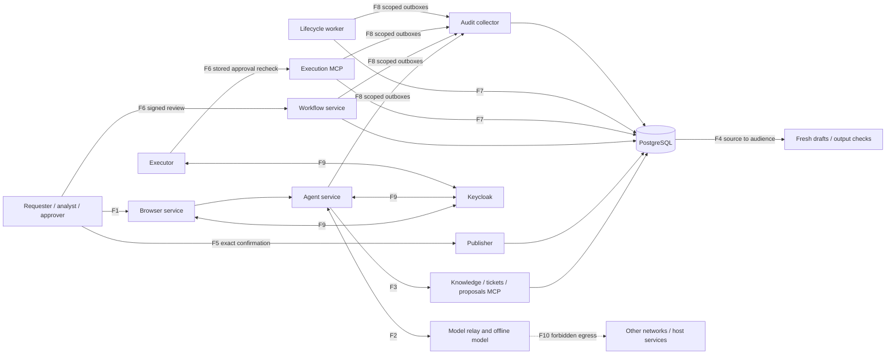

# Threat model: deployed synthetic lab through Phase 4

Reviewed October 14, 2026 against source revision `b627fb540e4a4816850344f43ecc660278f5c9af`, Phase 3/4 exit evidence and the [Phase 5 repeated evaluation](phase5-report.md). Phase 5 working-tree inputs are preserved by the evaluation freeze; no runtime authorization boundary changed. The [risk register](risk-register.md) is the source of threat IDs, ratings, decisions, owners and residual risks. Earlier Phase 0-only statements remain in repository history; they do not describe the current deployment.

Protected assets include document bodies and metadata, audience-specific tickets and drafts, effective grants, approvals, workload credentials, service availability and audit evidence. Business data and people are synthetic. The host/operator, Docker daemon, identity and policy administrators, and database administrator are trusted. Runtime principals have separate credentials and enforced boundaries; the agent and model cannot approve or execute grants.

| Actor | Controlled entry | Intended harm | Independent enforcement |
|---|---|---|---|
| External requester | Own ticket and plain-text content | Restricted answer or access | Recipient intersection, fresh context, exact review |
| Compromised employee | Account, permitted tickets/comments | Cross-team reads or self-grant | Signed identity, resource ACLs, separate approvers |
| Knowledge author | Retrieved document | Redirect later model actions | Untrusted provenance, downstream gateway/server policy |
| Compromised MCP service | Definitions, schemas, results | Tool misuse or credential reuse | Reviewed catalog, resource audiences, network policy |
| Faulty executor/worker or outage | Retries, delayed reconciliation, unavailable collector | Duplicate/stale grant or lost evidence | Atomic effects, immediate effective expiry, durable outbox |

This is a logical data-flow view, not a network allow-list. Browser-to-workflow and source-to-audience paths include trusted intermediaries. Each runtime process has the separate mounts, roles, listeners and inspected firewall rules described in the [Phase 4 runbook](phase4.md). F10 represents egress restrictions across all 14 namespaces, not only the model. The collector uses protected tables in the same PostgreSQL instance; the diagram does not imply a separate database or storage trust boundary.

| Flow | Threat IDs | Register decisions and evidence |
|---|---|---|
| F1 user to app | T-F1-S-01, T-F1-D-01 | RISK-01 identity; RISK-11 admission |
| F2 app/model proposals | T-F2-E-01, T-F2-D-01 | RISK-03 injection; RISK-11 budgets |
| F3 gateway/MCP | T-F3-I-01, T-F3-T-01 | RISK-02 resource ACLs; RISK-12 catalog integrity |
| F4 source/output audience | T-F4-I-01, T-F4-T-01 | RISK-04 disclosure; RISK-13 answer correctness |
| F5 confirmation/publication | T-F5-T-01 | RISK-05 immutable review, actual comment effects |
| F6 human approval/executor | T-F6-S-01, T-F6-E-01, T-F6-D-01 | RISK-06 approval authority; RISK-11 request spam |
| F7 executor/lifecycle/directory | T-F7-T-01, T-F7-E-01 | RISK-07 atomic grants, expiry, reviews |
| F8 producers/collector | T-F8-R-01, T-F8-I-01, T-F8-R-02 | RISK-08 durable/redacted audit; RISK-14 evidence claims |
| F9 app/services/identity | T-F9-S-01, T-F9-E-01 | RISK-09 issuer/client/audience checks |
| F10 runtime egress | T-F10-I-01 | RISK-10 positive-controlled IPv4 isolation |

STRIDE letters mean spoofing, tampering, repudiation, information disclosure, denial of service, and elevation of privilege. Retrieved prompt injection tampers with context and may seek elevated authority; descriptions of authorization in source prose do not become trusted identity or approval.

The [Phase 3 exit matrix](phase3-exit.md) and [Phase 4 exit matrix](phase4-exit.md) distinguish deterministic boundary tests, signed deployed workflows and real-model observations. The fixture-only SQLite harness remains unauthenticated and may report unsupported operations; the deployed application uses real Keycloak identity and PostgreSQL. Do not transfer a fixture result to the deployed agent without corresponding evidence.

Out of scope: host/admin compromise, malicious authorized humans manually copying data, production directory integrations, live email, executable attachments and confidentiality already entrusted to a fully compromised source service. Fingerprints/canaries do not prove absence of paraphrased or encoded leakage. IPv6 default denial is inspected, without live positive controls. Shared database administration, disposable tmpfs storage, fixed context recipes and conservative authorization invalidation remain limits. There is no multi-user host or enterprise-governance assurance claim.
